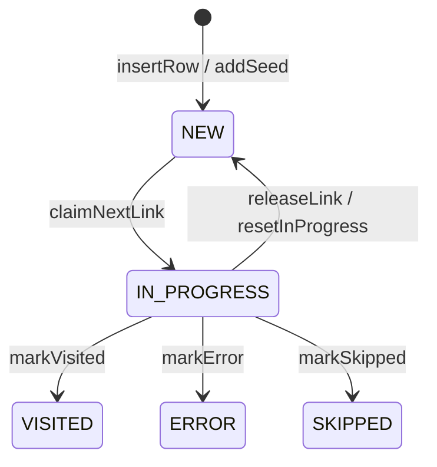
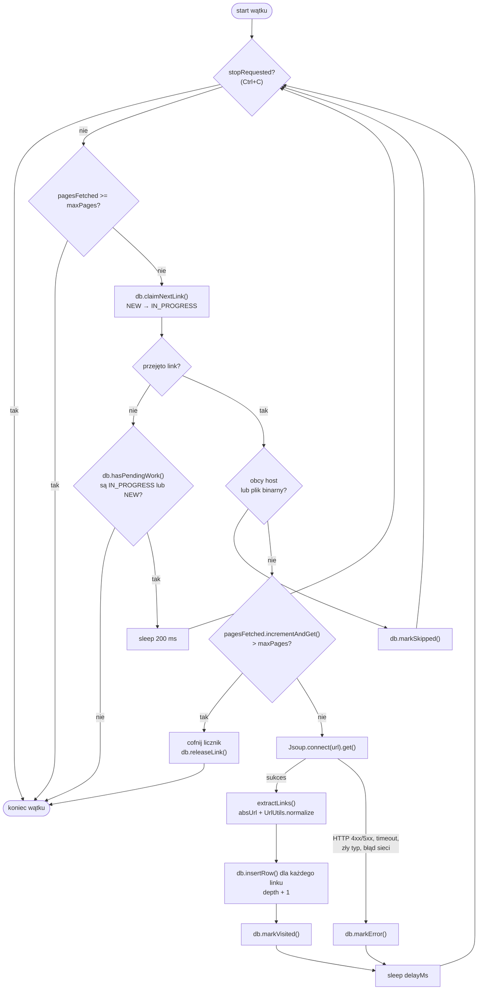

# Web Crawler

[](https://github.com/maciejHash/WebCrawler/actions/workflows/ci.yml)

Wielowątkowy robot internetowy w Javie, który przegląda strony WWW i zapisuje znalezione linki w bazie SQLite.

- liczba wątków ograniczona pulą `ExecutorService` o stałym rozmiarze,
- każdy wątek sam pobiera z bazy nieodwiedzone linki,
- wszystkie linki ze strony trafiają do bazy, a powtórne znalezienie zwiększa licznik `seen`,
- żadna strona nie jest pobierana dwa razy - pilnuje tego baza danych,
- przerwaną pracę można wznowić, bo cały stan jest w pliku bazy.

## Wymagania

- JDK 27
- Maven 3.9+

Zależności: [jsoup](https://jsoup.org) (pobieranie i parsowanie HTML), [sqlite-jdbc](https://github.com/xerial/sqlite-jdbc) (baza), JUnit 5 (testy).

## Budowanie

```bash
mvn verify
```

Kompiluje kod, uruchamia testy i buduje wykonywalny plik `target/web-crawler.jar`
(zawiera wszystkie zależności).

## Uruchamianie

```bash
java -jar target/web-crawler.jar https://books.toscrape.com --threads 4 --max-pages 50
java -jar target/web-crawler.jar --help
```

Alternatywnie, bez budowania JAR-a:

```bash
mvn -q compile exec:java -Dexec.args="https://books.toscrape.com --max-pages 20"
```

### Opcje wiersza poleceń

| Opcja | Domyślnie | Znaczenie |
|---|---|---|
| `<startUrl>` | – (wymagany) | Adres strony startowej, `http` lub `https`. Jest normalizowany tak samo jak każdy inny link. |
| `--threads N` | `4` | Liczba wątków w puli (`N >= 1`). |
| `--max-pages N` | `100` | Wspólny dla wszystkich wątków limit stron pobranych **w tym uruchomieniu** (`N >= 1`). |
| `--max-depth N` | `3` | Maksymalna głębokość; strona startowa ma 0, linki z niej 1 itd. (`N >= 0`). |
| `--delay MS` | `500` | Przerwa po każdym żądaniu (także nieudanym), żeby nie przeciążać serwera; `0` = bez przerwy. Przerwę robi każdy wątek osobno. |
| `--all-hosts` | wyłączone | Odwiedzaj też strony z innych hostów. Domyślnie tylko host startowy (`www.` i wielkość liter są pomijane). Linki do innych hostów i tak trafiają do bazy, a po przejęciu przez wątek dostają status `SKIPPED`. |
| `--db plik` | `crawler.db` | Plik bazy SQLite. |
| `--fresh` | wyłączone | Usuwa dane z bazy i zaczyna od nowa. Bez tej flagi robot wznawia pracę zapisaną w bazie. |
| `-h`, `--help` | | Wyświetla pomoc (działa nawet przy błędnych pozostałych argumentach). |

Każda opcja może wystąpić najwyżej raz. Błędne argumenty kończą program kodem 2, błąd bazy kodem 1.

Z wiersza poleceń nie da się ustawić limitu czasu żądania (10 000 ms) ani nagłówka
`User-Agent` (`pl.webcrawler/1.0 (student project)`) - są stałymi w `CrawlerConfig`.

### Wznawianie i Ctrl+C

- Bez `--fresh` robot kontynuuje poprzednią pracę: strony `VISITED`, `ERROR` i `SKIPPED` nie są pobierane
  ponownie, linki `NEW` czekają w kolejce, a linki `IN_PROGRESS` (przerwane w trakcie) wracają do `NEW`.
- Ctrl+C zatrzymuje robota łagodnie: wątki kończą bieżące strony, wypisywany jest raport,
  a nieodwiedzone linki czekają na następne uruchomienie.
- Limit `--max-pages` liczy strony tylko z bieżącego uruchomienia, więc można wznawiać pracę porcjami.

### Raport

Na końcu program wypisuje raport: liczbę linków w każdym statusie, 10 najczęściej
znajdowanych linków, liczbę stron pobranych przez każdy wątek i czas trwania.

## Architektura

Wszystkie klasy są w pakiecie `pl.webcrawler`.

| Klasa | Odpowiedzialność |
|---|---|
| `Main` | Parsowanie argumentów, uruchomienie `Crawler`, shutdown hook dla Ctrl+C, wypisanie raportu. |
| `CrawlerConfig` | Record z ustawieniami uruchomienia; sprawdza wartości i normalizuje adres startowy. |
| `Crawler` | Przygotowuje bazę, tworzy pulę wątków (`Executors.newFixedThreadPool`), czeka na koniec, zbiera statystyki. |
| `CrawlerThread` | `Runnable` - pętla: przejmij link → pobierz stronę → wyciągnij linki → zapisz je → oznacz stronę. |
| `DBConn` | Cały SQL; jedna instancja współdzielona przez wątki, metody publiczne `synchronized`. |
| `LinkRecord` | Record `(id, url, depth)` - link przejęty przez wątek. |
| `UrlUtils` | Normalizacja adresów, porównywanie hostów, rozpoznawanie plików binarnych. |
| `DatabaseException` | Niekontrolowany wyjątek opakowujący `SQLException`. |

Wątki nazywają się `crawler-1`, `crawler-2`, ... - ta nazwa jest w każdej linii logu i w kolumnie `claimed_by`.

## Baza danych

### Tabela `links`

```sql
CREATE TABLE IF NOT EXISTS links (
    id         INTEGER PRIMARY KEY AUTOINCREMENT,
    url        TEXT    NOT NULL UNIQUE,
    depth      INTEGER NOT NULL,
    seen       INTEGER NOT NULL DEFAULT 1,
    status     TEXT    NOT NULL DEFAULT 'NEW',
    claimed_by TEXT,
    found_at   TEXT DEFAULT CURRENT_TIMESTAMP,
    visited_at TEXT,
    error      TEXT
);

CREATE INDEX IF NOT EXISTS idx_links_status_depth ON links (status, depth);
```

| Kolumna | Znaczenie |
|---|---|
| `id` | Klucz; kolejność znalezienia linku. Wątki biorą linki od najmniejszego `id`. |
| `url` | Znormalizowany adres (`UrlUtils.normalize`). `UNIQUE` - każdy adres występuje raz. |
| `depth` | Najmniejsza znana głębokość (odległość od strony startowej w kliknięciach). |
| `seen` | Ile razy link znaleziono na odwiedzonych stronach (każde wystąpienie, także na tej samej stronie). |
| `status` | Stan linku - patrz niżej. |
| `claimed_by` | Nazwa wątku, który przejął link; zostaje po zakończeniu, stąd statystyka stron na wątek. |
| `found_at` | Kiedy link pierwszy raz trafił do bazy (UTC). |
| `visited_at` | Kiedy link otrzymał status końcowy (UTC). |
| `error` | Opis błędu dla statusu `ERROR`, np. `HTTP 404`. |

Indeks na `(status, depth)` przyspiesza najczęstsze zapytanie: „daj linki `NEW` o głębokości do `maxDepth`”.

### Statusy



| Status | Znaczenie |
|---|---|
| `NEW` | Znaleziony, czeka na odwiedzenie. Linki z `depth > maxDepth` zostają `NEW` na zawsze (albo do uruchomienia z większym `--max-depth`). |
| `IN_PROGRESS` | Przejęty przez wątek (`claimed_by`), który właśnie go przetwarza. |
| `VISITED` | Strona pobrana, linki z niej zapisane. |
| `ERROR` | Żądanie się nie powiodło: kod HTTP 4xx/5xx, typ treści inny niż HTML/XML, przekroczony czas, błąd sieci. Opis w `error`. |
| `SKIPPED` | Pominięty bez żądania HTTP: inny host (bez `--all-hosts`) albo plik binarny po rozszerzeniu (`.pdf`, `.jpg`, `.zip`, ...). |

Link wraca z `IN_PROGRESS` do `NEW`, gdy wątek oddaje go po wyczerpaniu limitu stron lub przerwaniu
(`releaseLink`) albo przy starcie programu po przerwanym uruchomieniu (`resetInProgress`).

### Przydatne zapytania

```bash
sqlite3 crawler.db "SELECT status, COUNT(*) FROM links GROUP BY status;"
sqlite3 crawler.db "SELECT url, seen FROM links ORDER BY seen DESC LIMIT 10;"
sqlite3 crawler.db "SELECT url, error FROM links WHERE status = 'ERROR';"
```

## Pętla `CrawlerThread`



Kolejność „najpierw `insertRow`, potem `markVisited`” jest celowa: dopóki strona jest `IN_PROGRESS`,
inne wątki widzą w `hasPendingWork`, że praca może się jeszcze pojawić, i czekają zamiast kończyć.
Gdyby strona została oznaczona jako `VISITED` przed zapisaniem linków, pozostałe wątki mogłyby
zakończyć się w tej krótkiej chwili, zostawiając całą pracę jednemu wątkowi.

Przerwanie wątku (np. `shutdownNow`) w trakcie pobierania oddaje link (`releaseLink`) - strona
nie jest wadliwa, więc nie dostaje statusu `ERROR`.

## Jak unikamy wielokrotnych odwiedzin

Ochrona ma kilka warstw. Najważniejsze są dwie pierwsze - to baza danych, a nie kod Javy,
rozstrzyga, czy link jest nowy i do kogo należy.

### 1. `url UNIQUE` i zapis jednym zapytaniem (UPSERT)

```sql
INSERT INTO links (url, depth) VALUES (?, ?)
ON CONFLICT(url) DO UPDATE SET
    seen  = seen + 1,
    depth = MIN(depth, excluded.depth)
```

Nie ma osobnego „sprawdź, czy istnieje” i „wstaw”. Przy dwóch krokach dwa wątki mogłyby jednocześnie
zobaczyć, że linku nie ma, i oba go wstawić. Tutaj ograniczenie `UNIQUE` gwarantuje jeden wiersz na adres,
a konflikt zamienia się w zwiększenie `seen`. `MIN(depth, ...)` zapamiętuje krótszą drogę do strony.

Adres startowy jest dodawany inaczej - ponowne uruchomienie to wznowienie, a nie kolejne znalezienie linku,
więc `seen` nie może wzrosnąć:

```sql
INSERT OR IGNORE INTO links (url, depth) VALUES (?, 0)
```

### 2. Przejęcie linku warunkowym `UPDATE`

```sql
-- kandydaci: najstarsze linki NEW w dozwolonej głębokości (po 20 naraz)
SELECT id, url, depth FROM links
WHERE status = 'NEW' AND depth <= ?
ORDER BY id
LIMIT ?;

-- próba przejęcia jednego kandydata
UPDATE links SET status = 'IN_PROGRESS', claimed_by = ?
WHERE id = ? AND status = 'NEW';
```

Warunek `status = 'NEW'` jest sprawdzany przez bazę w chwili zapisu, a zapisy w SQLite są szeregowane.
Jeśli dwa wątki spróbują przejąć ten sam link, tylko pierwszy zmieni wiersz. Link należy do wątku
**tylko wtedy, gdy `executeUpdate()` zwróci 1**. Przy 0 wątek próbuje kolejnego kandydata,
a po wyczerpaniu listy pobiera nową.

Wynik `SELECT`-a jest wczytywany do listy i zamykany przed pierwszym `UPDATE`-em - otwarty odczyt
trzymałby w SQLite stary obraz bazy i zapis mógłby się nie udać (`SQLITE_BUSY`).

### 3. Jedno współdzielone połączenie, metody `synchronized`

Wszystkie wątki używają jednej instancji `DBConn`, a jej metody publiczne są `synchronized`:
obiekt `Connection` z JDBC nie jest bezpieczny wielowątkowo, a dzięki temu z połączenia korzysta
w danej chwili tylko jeden wątek. Baza działa w trybie WAL z limitem oczekiwania na blokadę:

```sql
PRAGMA journal_mode=WAL;     -- odczyty nie blokują zapisu
PRAGMA busy_timeout=5000;    -- przy zablokowanym pliku czekaj do 5 s zamiast zgłaszać błąd
```

Warstwy 1 i 2 nie zależą od `synchronized` - test `DBConnConcurrencyTest` sprawdza, że także przy
osobnym połączeniu dla każdego wątku żaden link nie zostaje przejęty dwa razy.

### 4. Normalizacja adresów przed zapisem

`UNIQUE` porównuje teksty, więc ta sama strona zapisana na dwa sposoby dałaby dwa wiersze
i dwa pobrania. Dlatego każdy adres (także startowy) przechodzi przez `UrlUtils.normalize`:

| Przed | Po | Reguła |
|---|---|---|
| `https://example.com/page#section` | `https://example.com/page` | fragment usunięty |
| `HTTPS://Example.COM/Page` | `https://example.com/Page` | schemat i host małymi literami, ścieżka bez zmian |
| `http://example.com:80/a` | `http://example.com/a` | port domyślny usunięty |
| `https://example.com` | `https://example.com/` | pusta ścieżka → `/` |
| `https://example.com/my page` | `https://example.com/my%20page` | spacje i znaki spoza ASCII kodowane w UTF-8 |
| `mailto:a@b.pl`, `javascript:...` | odrzucony | tylko `http` i `https` |

### 5. Wznowienie po przerwanym uruchomieniu

```sql
UPDATE links SET status = 'NEW', claimed_by = NULL
WHERE status = 'IN_PROGRESS';
```

Przy starcie nie działa jeszcze żaden wątek, więc linki `IN_PROGRESS` zostały po poprzednim, przerwanym
uruchomieniu i nie mają właściciela. Bez tego kroku nikt by ich nie odwiedził, a `hasPendingWork`
wiecznie widziałby niedokończoną pracę.

### Koniec pracy i limit stron

Wątek kończy pracę, gdy nie może przejąć linku, a jedno zapytanie pokazuje, że nie ma już nic do zrobienia:

```sql
SELECT EXISTS (
    SELECT 1 FROM links
    WHERE status = 'IN_PROGRESS' OR (status = 'NEW' AND depth <= ?)
);
```

Jedno zapytanie zamiast dwóch, bo dwa osobne mogłyby zobaczyć bazę w dwóch różnych chwilach.
Jeśli praca jeszcze jest (inny wątek przetwarza stronę i może dodać linki), wątek czeka 200 ms.

Limit `--max-pages` to jeden `AtomicInteger` wspólny dla wszystkich wątków. Miejsce jest rezerwowane
przez `incrementAndGet()` tuż przed żądaniem HTTP - operacja atomowa, więc dokładnie `maxPages` wątków
dostanie wartość mieszczącą się w limicie. Wątek, który się nie zmieścił, cofa licznik i oddaje link do `NEW`.

## Testy

```bash
mvn -q verify
```

Testy nie łączą się z internetem: HTML jest parsowany z pamięci (`Jsoup.parse`) albo serwowany przez
lokalny `com.sun.net.httpserver.HttpServer` z JDK.

| Test | Co sprawdza |
|---|---|
| `UrlUtilsTest` | Normalizacja, porównywanie hostów, pliki binarne. |
| `CrawlerThreadTest` | `extractLinks` na HTML z pamięci. |
| `DBConnTest` | Każda metoda `DBConn` na pliku SQLite w katalogu tymczasowym. |
| `DBConnConcurrencyTest` | 8 wątków przejmuje 200 linków - każdy link trafia do dokładnie jednego wątku (wspólne i osobne połączenia, test powtarzany). |
| `CrawlerThreadRunTest` | Cała pętla `run()` na lokalnej stronie: statusy, `seen`, limit stron, zatrzymanie. |
| `CrawlerTest`, `CrawlerEndToEndTest` | Cały robot z pulą wątków: każda strona pobrana dokładnie raz (licznik żądań po stronie serwera), cykle, duplikaty, 404, wznowienie. |
| `MainTest` | Parsowanie argumentów, pomoc, tekst raportu. |

GitHub Actions (`.github/workflows/ci.yml`) uruchamia `mvn -B verify` na JDK 27 przy każdym pushu
do `main` i każdym pull requeście, a gotowy `web-crawler.jar` zapisuje jako artefakt.

## Ograniczenia

- **Brak obsługi `robots.txt`** ani meta tagu `robots` - robot nie sprawdza, czy właściciel strony pozwala na indeksowanie.
- **Tylko statyczny HTML.** jsoup nie wykonuje JavaScriptu, więc linki dodawane przez skrypty nie są widoczne.
- **Przekierowania.** jsoup podąża za przekierowaniami, ale w bazie zostaje adres pierwotny. Dwa adresy
  przekierowujące na tę samą stronę (np. `/a` i `/a/`) to dwa wiersze i dwa pobrania. Normalizacja nie
  zna też `<link rel="canonical">`, kolejności parametrów w query stringu ani końcowego `/`.
- **Przerwa `--delay` jest na wątek, nie na serwer** - przy 4 wątkach serwer dostaje do 4 żądań w czasie jednej przerwy.
- **Pliki binarne rozpoznawane po rozszerzeniu.** `/pobierz.php?f=a.pdf` zostanie pobrany; jsoup odrzuci go
  dopiero po nagłówku `Content-Type` (status `ERROR`).
- **Zapis strony nie jest transakcją.** Jeśli program zostanie przerwany po zapisaniu części linków,
  a przed `markVisited`, przy wznowieniu strona zostanie pobrana ponownie, a `seen` jej linków wzrośnie drugi raz.
- **Jedno połączenie z bazą** - wszystkie operacje na bazie są wykonywane po kolei. Przy kilku wątkach
  wąskim gardłem jest sieć, ale przy dziesiątkach wątków byłaby nim baza.
- **Domeny IDN** (z polskimi znakami w nazwie hosta) są odrzucane.
- `www.` jest pomijane przy porównywaniu hostów, ale inne subdomeny (`blog.example.com`) to już inny host.
- Limit czasu żądania i `User-Agent` nie są ustawiane z wiersza poleceń.

## Pomysły na rozwój

- Pobieranie i respektowanie `robots.txt` (w tym `Crawl-delay`).
- Wspólny limit tempa na host zamiast przerwy w każdym wątku.
- Zapisywanie adresu docelowego po przekierowaniu i `rel="canonical"`, żeby wykrywać kolejne duplikaty.
- Zapis linków strony i `markVisited` w jednej transakcji (szybciej i bez podwójnego `seen` przy wznowieniu).
- Ponawianie stron z błędem przejściowym (timeout, HTTP 5xx) z ograniczoną liczbą prób.
- Kolejność odwiedzin według głębokości (`ORDER BY depth, id`) - ścisłe przeszukiwanie wszerz.
- Opcje `--timeout` i `--user-agent` w wierszu poleceń.
- Odczyt `sitemap.xml` jako dodatkowego źródła linków.
- Eksport wyników (CSV, graf linków między stronami - wymagałby tabeli krawędzi).
