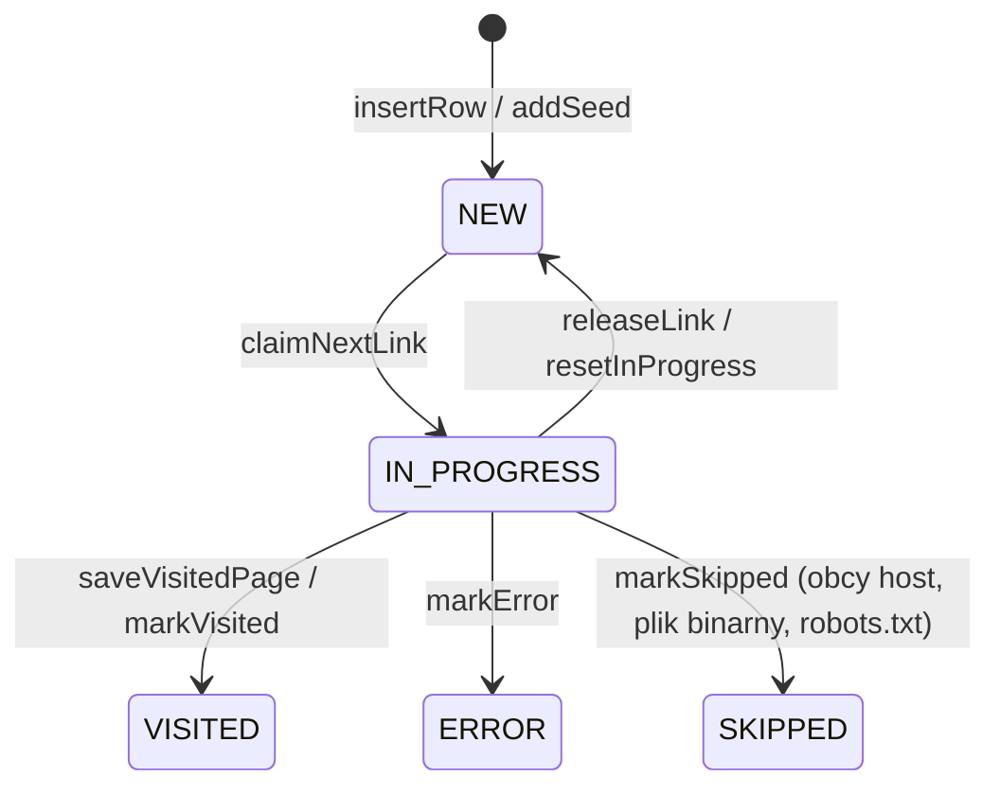
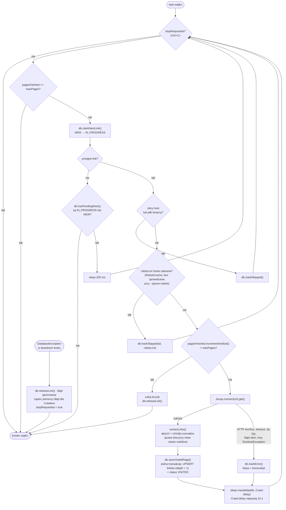

# Web Crawler

[](https://github.com/maciejHash/WebCrawler/actions/workflows/ci.yml)

Wielowątkowy robot internetowy w Javie, który przegląda strony WWW i zapisuje znalezione linki w bazie SQLite.

- liczba wątków ograniczona pulą `ExecutorService` o stałym rozmiarze,
- każdy wątek sam pobiera z bazy nieodwiedzone linki,
- wszystkie linki ze strony trafiają do bazy, a powtórne znalezienie zwiększa licznik `seen`,
- żadna strona nie jest pobierana dwa razy - pilnuje tego baza danych,
- przerwaną pracę można wznowić, bo cały stan jest w pliku bazy,
- respektuje `robots.txt` (w tym `Crawl-delay`) i meta tag `robots` z `nofollow`.

## Wymagania

- JDK 27
- Maven 3.9+

Zależności: [jsoup](https://jsoup.org) (pobieranie i parsowanie HTML), [sqlite-jdbc](https://github.com/xerial/sqlite-jdbc) (baza), JUnit 5 (testy).

## Budowanie

```bash
mvn verify
```

Kompiluje kod, uruchamia testy i buduje wykonywalny plik `target/web-crawler.jar`
(zawiera wszystkie zależności).

## Uruchamianie

```bash
java -jar target/web-crawler.jar https://books.toscrape.com --threads 4 --max-pages 50
java -jar target/web-crawler.jar --help
java -jar target/web-crawler.jar --version
```

Alternatywnie, bez budowania JAR-a:

```bash
mvn -q compile exec:java -Dexec.args="https://books.toscrape.com --max-pages 20"
```

### Opcje wiersza poleceń

| Opcja | Domyślnie | Znaczenie |
|---|---|---|
| `<startUrl>` | – (wymagany) | Adres strony startowej, `http` lub `https`. Jest normalizowany tak samo jak każdy inny link. |
| `--threads N` | `4` | Liczba wątków w puli (`N >= 1`). |
| `--max-pages N` | `100` | Wspólny dla wszystkich wątków limit stron pobranych **w tym uruchomieniu** (`N >= 1`). |
| `--max-depth N` | `3` | Maksymalna głębokość; strona startowa ma 0, linki z niej 1 itd. (`N >= 0`). |
| `--delay MS` | `500` | Przerwa po każdym żądaniu (także nieudanym), żeby nie przeciążać serwera; `0` = bez przerwy. Przerwę robi każdy wątek osobno. Gdy `robots.txt` hosta podaje dłuższy `Crawl-delay`, obowiązuje on (najwyżej 10 s) - patrz [Crawl-delay](#crawl-delay). |
| `--timeout MS` | `10000` | Limit czasu jednego żądania HTTP w milisekundach (`MS >= 1`). Strona, która nie odpowie w tym czasie, dostaje status `ERROR`. Od tej wartości zależy też, jak długo Ctrl+C czeka na zakończenie wątków. |
| `--user-agent TEKST` | `pl.webcrawler/<wersja> (student project)` | Nagłówek `User-Agent` wysyłany z każdym żądaniem. Niepusty, tylko drukowalne znaki ASCII (od spacji do `~`) - polskie litery, tabulator czy znak nowej linii kończą program błędem. Wartość ze spacjami trzeba ująć w cudzysłów. |
| `--all-hosts` | wyłączone | Odwiedzaj też strony z innych hostów. Domyślnie tylko host startowy (`www.` i wielkość liter są pomijane). Linki do innych hostów i tak trafiają do bazy, a po przejęciu przez wątek dostają status `SKIPPED`. |
| `--ignore-robots` | wyłączone | Nie pobiera `robots.txt` i odwiedza także strony, których zabrania; `Crawl-delay` też nie obowiązuje. Meta tag `robots` z `nofollow` jest respektowany zawsze. Patrz [robots.txt](#robotstxt). |
| `--db plik` | `crawler.db` | Plik bazy SQLite. |
| `--fresh` | wyłączone | Usuwa dane z bazy i zaczyna od nowa. Bez tej flagi robot wznawia pracę zapisaną w bazie. |
| `-h`, `--help` | | Wyświetla pomoc (działa nawet przy błędnych pozostałych argumentach). |
| `--version` | | Wypisuje `Web Crawler <wersja>` i kończy program kodem 0 (też przy błędnych pozostałych argumentach). |

Każda opcja może wystąpić najwyżej raz. Błędne argumenty kończą program kodem 2, błąd bazy kodem 1.

### Wznawianie i Ctrl+C

- Bez `--fresh` robot kontynuuje poprzednią pracę: strony `VISITED`, `ERROR` i `SKIPPED` nie są pobierane
  ponownie, linki `NEW` czekają w kolejce, a linki `IN_PROGRESS` (przerwane w trakcie) wracają do `NEW`.
- Ctrl+C zatrzymuje robota łagodnie: wątki kończą bieżące strony, wypisywany jest raport,
  a nieodwiedzone linki czekają na następne uruchomienie. Program czeka na wątki najwyżej
  2 × `--timeout` (`robots.txt` i strona) + dłuższa z wartości `--delay` i 10 s (`Crawl-delay`) + 5 s;
  z `--ignore-robots` - `--timeout` + `--delay` + 5 s.
- Limit `--max-pages` liczy strony tylko z bieżącego uruchomienia, więc można wznawiać pracę porcjami.

### Raport

Na końcu program wypisuje raport: liczbę linków w każdym statusie, 10 najczęściej
znajdowanych linków, liczbę stron pobranych przez każdy wątek i czas trwania.

## robots.txt

Domyślnie robot respektuje `robots.txt` - plik, w którym właściciel serwisu opisuje, czego roboty
nie powinny pobierać. Obsługa to uproszczona wersja [RFC 9309](https://www.rfc-editor.org/rfc/rfc9309).
`--ignore-robots` wyłącza ją całkowicie: plik nie jest pobierany, a zabronione strony są odwiedzane.

### Pobieranie

Przed pierwszą stroną z danego hosta wątek pobiera `scheme://host:port/robots.txt` - z tym samym
`User-Agent` i `--timeout` co strony, najwyżej 500 KiB. `RobotsCache` zapamiętuje wynik do końca
uruchomienia, więc każdy host jest pytany raz, niezależnie od liczby wątków. Plik nie trafia do tabeli
`links` i nie liczy się do `--max-pages`. Linki do obcych hostów (bez `--all-hosts`) i do plików binarnych
są pomijane wcześniej, więc dla nich `robots.txt` nie jest pobierany.

| Odpowiedź serwera | Skutek |
|---|---|
| 2xx | Reguły z pliku. |
| 4xx (np. 404 - pliku nie ma) | Brak ograniczeń. |
| 5xx, przekroczony czas, błąd sieci | Wszystkie strony hosta zabronione do końca uruchomienia - nie wiadomo, na co host pozwala. |

Metoda `RobotsCache.rulesFor` jest w całości `synchronized`, razem z pobieraniem. To celowe uproszczenie:
dwa wątki nie pobiorą pliku tego samego hosta naraz i nie trzeba osobnej blokady dla każdego hosta.
Zwykle odwiedzamy jeden host, więc pozostałe wątki czekają tylko raz, na początku pracy. Przy `--all-hosts`
wątek czeka też wtedy, gdy inny pobiera `robots.txt` innego hosta.

Przerwanie wątku w trakcie pobierania `robots.txt` (np. `shutdownNow`) nie jest zapamiętywane jako
odpowiedź hosta - link wraca do `NEW`, tak jak przy przerwaniu pobierania strony.

### Wybór grupy i reguły

Plik składa się z grup: jedna lub kilka linii `User-agent`, a pod nimi reguły. Robot szuka grupy,
której nazwa (bez względu na wielkość liter) to token produktu z jego `User-Agent` - część przed
pierwszym `/` albo spacją, czyli domyślnie `pl.webcrawler`. Jeśli takiej nie ma, bierze grupę `*`,
a bez żadnej z nich wolno wszystko. Kilka grup o tej samej nazwie jest łączonych w jedną.

Reguły są porównywane ze ścieżką i query stringiem znormalizowanego adresu (`/szukaj?q=java`):

- wygrywa reguła o najdłuższym pasującym wzorcu, a przy remisie `Allow`; gdy nie pasuje żadna - wolno,
- wzorzec pasuje do początku ścieżki, `*` oznacza dowolny ciąg znaków, a `$` na końcu - koniec adresu,
- pusty `Disallow:` niczego nie blokuje,
- komentarze `#`, puste linie, BOM, końce linii CRLF, nieznane dyrektywy (np. `Sitemap`) i linie
  bez dwukropka są pomijane.

```
User-agent: *
Disallow: /shop
Allow: /shop/public
Disallow: /*.pdf$
Crawl-delay: 1.5
```

| Ścieżka | Wynik | Dlaczego |
|---|---|---|
| `/shop/cart` | zabroniona | pasuje tylko `Disallow: /shop` |
| `/shop/public/list` | dozwolona | `Allow: /shop/public` jest dłuższy niż `Disallow: /shop` |
| `/files/a.pdf` | zabroniona | `*` pasuje do `files/a`, a `$` - do końca adresu |
| `/files/a.pdf?v=2` | dozwolona | `$` wymaga, żeby adres kończył się na `.pdf` |
| `/about` | dozwolona | nie pasuje żadna reguła |

Strona zabroniona dostaje status `SKIPPED` z `error = 'robots.txt'`, bez żądania HTTP i bez zajmowania
miejsca w `--max-pages`. To status końcowy: przy wznowieniu (także z `--ignore-robots`) strona nie jest
pobierana - żeby ją odwiedzić, trzeba zacząć od nowa z `--fresh`. Dotyczy to też stron pominiętych dlatego,
że `robots.txt` był niedostępny (5xx, timeout).

### Crawl-delay

`Crawl-delay` z wybranej grupy podaje w sekundach (także ułamkowych, np. `1.5`) minimalną przerwę
między żądaniami. Przerwa po każdym żądaniu to dłuższa z wartości `--delay` i `Crawl-delay`, przy czym
`Crawl-delay` jest ograniczony do 10 s (`CrawlerConfig.MAX_CRAWL_DELAY_MS`): plik pisze właściciel serwera,
a wartość typu `3600` zatrzymałaby wątek na godzinę po każdej stronie. `--delay` nie jest ograniczane -
tę wartość użytkownik wybrał sam. Tak jak `--delay`, przerwę robi każdy wątek osobno.

### Meta tag robots

Strona z `<meta name="robots" content="nofollow">` (albo `none`; wielkość liter bez znaczenia, wartości
rozdzielone przecinkami lub spacjami) dostaje status `VISITED`, ale jej linki nie trafiają do bazy.
Meta tag jest respektowany zawsze, także z `--ignore-robots`. `noindex` nie ma znaczenia - robot
nie indeksuje treści.

### Uproszczenia względem RFC 9309

- Wzorce są porównywane dosłownie, bez sprowadzania kodowania `%XX` do jednej postaci
  (`/%7Ea` i `/~a` to dla robota różne ścieżki).
- Nazwa grupy musi być równa tokenowi - `User-agent: pl.webcrawler/1.2` nie pasuje.
- Plik nie jest odświeżany w trakcie uruchomienia; nowe uruchomienie (także wznowienie) pobiera go od nowa.
- Nie są obsługiwane: `Sitemap`, nagłówek `X-Robots-Tag` i `rel="nofollow"` przy pojedynczych linkach.

## Architektura

Wszystkie klasy są w pakiecie `pl.webcrawler`.

| Klasa | Odpowiedzialność |
|---|---|
| `Main` | Parsowanie argumentów, uruchomienie `Crawler`, shutdown hook dla Ctrl+C, wypisanie raportu. |
| `CrawlerConfig` | Record z ustawieniami uruchomienia; sprawdza wartości i normalizuje adres startowy. |
| `Crawler` | Przygotowuje bazę, tworzy pulę wątków (`Executors.newFixedThreadPool`), czeka na koniec, zbiera statystyki. |
| `CrawlerThread` | `Runnable` - pętla: przejmij link → sprawdź `robots.txt` → pobierz stronę → wyciągnij linki → zapisz je → oznacz stronę. |
| `RobotsTxt` | Reguły z `robots.txt` dla naszego robota: wybór grupy, `Allow`/`Disallow` (najdłuższe dopasowanie, `*`, `$`), `Crawl-delay`. Sama logika, bez sieci. |
| `RobotsCache` | Pobiera `robots.txt` każdego hosta najwyżej raz na uruchomienie; jedna instancja wspólna dla wątków. |
| `DBConn` | Cały SQL; jedna instancja współdzielona przez wątki, metody publiczne `synchronized`. |
| `LinkRecord` | Record `(id, url, depth)` - link przejęty przez wątek. |
| `AppVersion` | Wersja programu wczytana z `webcrawler-version.properties` (wartość zapasowa `dev`). |
| `UrlUtils` | Normalizacja adresów, porównywanie hostów, rozpoznawanie plików binarnych. |
| `DatabaseException` | Niekontrolowany wyjątek opakowujący `SQLException`. |

Wątki nazywają się `crawler-1`, `crawler-2`, ... - ta nazwa jest w każdej linii logu i w kolumnie `claimed_by`.

## Baza danych

### Tabela `links`

```sql
CREATE TABLE IF NOT EXISTS links (
    id         INTEGER PRIMARY KEY AUTOINCREMENT,
    url        TEXT    NOT NULL UNIQUE,
    depth      INTEGER NOT NULL,
    seen       INTEGER NOT NULL DEFAULT 1,
    status     TEXT    NOT NULL DEFAULT 'NEW',
    claimed_by TEXT,
    found_at   TEXT DEFAULT CURRENT_TIMESTAMP,
    visited_at TEXT,
    error      TEXT
);

CREATE INDEX IF NOT EXISTS idx_links_status_depth ON links (status, depth);
```

| Kolumna | Znaczenie |
|---|---|
| `id` | Klucz; kolejność znalezienia linku. Wątki biorą najpierw linki o najmniejszym `depth`, a przy równej głębokości - od najmniejszego `id`. |
| `url` | Znormalizowany adres (`UrlUtils.normalize`). `UNIQUE` - każdy adres występuje raz. |
| `depth` | Najmniejsza znana głębokość (odległość od strony startowej w kliknięciach). |
| `seen` | Ile razy link znaleziono na odwiedzonych stronach (każde wystąpienie, także na tej samej stronie). |
| `status` | Stan linku - patrz niżej. |
| `claimed_by` | Nazwa wątku, który przejął link; zostaje po zakończeniu, stąd statystyka stron na wątek. |
| `found_at` | Kiedy link pierwszy raz trafił do bazy (UTC). |
| `visited_at` | Kiedy link otrzymał status końcowy (UTC). |
| `error` | Opis błędu dla statusu `ERROR`, np. `HTTP 404`, albo powód pominięcia dla `SKIPPED` (`robots.txt`). |

Indeks na `(status, depth)` przyspiesza najczęstsze zapytanie: „daj linki `NEW` o głębokości do `maxDepth`,
od najpłytszych” - i od razu podaje je w tej kolejności (patrz [punkt 2](#2-przejęcie-linku-warunkowym-update)).

### Statusy



| Status | Znaczenie |
|---|---|
| `NEW` | Znaleziony, czeka na odwiedzenie. Linki z `depth > maxDepth` zostają `NEW` na zawsze (albo do uruchomienia z większym `--max-depth`). |
| `IN_PROGRESS` | Przejęty przez wątek (`claimed_by`), który właśnie go przetwarza. |
| `VISITED` | Strona pobrana, linki z niej zapisane. |
| `ERROR` | Obsługa strony się nie powiodła: kod HTTP 4xx/5xx, typ treści inny niż HTML/XML, przekroczony czas, błąd sieci albo inny nieoczekiwany wyjątek (wtedy w `error` jest nazwa klasy i komunikat). Opis w `error`. |
| `SKIPPED` | Pominięty bez żądania HTTP: inny host (bez `--all-hosts`), plik binarny po rozszerzeniu (`.pdf`, `.jpg`, `.zip`, ...) albo strona zabroniona w `robots.txt` - wtedy w `error` jest `robots.txt` (patrz [robots.txt](#robotstxt)). |

Link wraca z `IN_PROGRESS` do `NEW`, gdy wątek oddaje go po wyczerpaniu limitu stron, przerwaniu
lub błędzie bazy (`releaseLink`) albo przy starcie programu po przerwanym uruchomieniu (`resetInProgress`).

### Wersje schematu

Numer wersji schematu jest zapisany w samym pliku bazy (`PRAGMA user_version`; nowy plik ma 0).
`DBConn.MIGRATIONS` to lista migracji - migracja na pozycji *n* (licząc od 1) prowadzi do wersji *n*.

| Wersja | Zmiana |
|---|---|
| 0 | Pusty plik albo baza z wersji programu sprzed wersjonowania. |
| 1 | Tabela `links` i indeks `idx_links_status_depth`. |

`createTables()` odczytuje `user_version` i wykonuje po kolei brakujące migracje. Każda migracja razem
z ustawieniem nowego `user_version` to osobna transakcja, więc przerwanie programu nie zostawi migracji
wykonanej w połowie. Baza z wersją wyższą niż znana programowi (utworzona przez nowszą wersję) kończy
się błędem `DatabaseException` - starszy program nie zna jej tabel i kolumn, więc jej nie zmienia.

Migracja 1 używa `IF NOT EXISTS`: na bazie ze starszej wersji programu (tabela jest, `user_version = 0`)
tylko ustawia wersję 1, a dane zostają. `dropTables()` (`--fresh`) usuwa tabelę i zeruje `user_version`
w jednej transakcji. Zmianę schematu dodaje się jako nową migrację na końcu listy - istniejących się
nie zmienia, bo bazy, które już je mają, nie wykonają ich drugi raz.

### Przydatne zapytania

```bash
sqlite3 crawler.db "SELECT status, COUNT(*) FROM links GROUP BY status;"
sqlite3 crawler.db "SELECT url, seen FROM links ORDER BY seen DESC LIMIT 10;"
sqlite3 crawler.db "SELECT url, error FROM links WHERE status = 'ERROR';"
sqlite3 crawler.db "SELECT url FROM links WHERE status = 'SKIPPED' AND error = 'robots.txt';"
sqlite3 crawler.db "PRAGMA user_version;"
```

## Pętla `CrawlerThread`



Linki strony i jej status `VISITED` są zapisywane w jednej transakcji (`saveVisitedPage`), więc żaden
wątek nie zobaczy strony `VISITED` bez jej linków. To ważne dla kończenia pracy: dopóki strona jest
`IN_PROGRESS`, inne wątki widzą w `hasPendingWork`, że praca może się jeszcze pojawić, i czekają zamiast kończyć.
Gdyby `VISITED` pojawiło się przed linkami, pozostałe wątki mogłyby zakończyć się w tej krótkiej chwili,
zostawiając całą pracę jednemu wątkowi.

Przerwanie wątku (np. `shutdownNow`) w trakcie pobierania strony albo jej `robots.txt` oddaje link
(`releaseLink`) - strona nie jest wadliwa, więc nie dostaje statusu `ERROR` ani `SKIPPED`. Dlatego `Crawler` po `shutdownNow()` czeka jeszcze
na wątki (najwyżej limit czasu jednego żądania), zanim zamknie bazę - inaczej wątek trafiłby na zamknięte połączenie.

### Wyjątki w wątku

Wątek, który zginąłby od nieobsłużonego wyjątku, zostawiłby swój link `IN_PROGRESS` na zawsze, a pozostałe
wątki widziałyby go w `hasPendingWork` i czekały bez końca. Dlatego są dwa rodzaje błędów:

- **Błąd jednej strony** - każdy wyjątek przy pobieraniu, parsowaniu i zapisie linków tej strony
  (wyjątki jsoup, `IOException`, dowolny `RuntimeException`) **poza** `DatabaseException`. Strona dostaje
  status `ERROR` z nazwą klasy i komunikatem, a wątek bierze kolejny link.
- **Błąd bazy** (`DatabaseException`) - dalsza praca nie ma sensu, bo każdy kolejny zapis też może się nie udać.
  Wątek próbuje oddać link (`releaseLink`; jeśli i to się nie uda, link zostaje `IN_PROGRESS`, a przy następnym
  starcie przywróci go `resetInProgress`), zapisuje pierwszy taki wyjątek we wspólnym
  `AtomicReference<DatabaseException>`, ustawia `stopRequested` i kończy się. Pozostałe wątki zatrzymują się
  łagodnie - jak po Ctrl+C. Gdy wszystkie skończą, `Crawler.run()` rzuca zapisany wyjątek, a `Main`
  kończy program kodem 1.

## Jak unikamy wielokrotnych odwiedzin

Ochrona ma kilka warstw. Najważniejsze są dwie pierwsze - to baza danych, a nie kod Javy,
rozstrzyga, czy link jest nowy i do kogo należy.

### 1. `url UNIQUE` i zapis jednym zapytaniem (UPSERT)

```sql
INSERT INTO links (url, depth) VALUES (?, ?)
ON CONFLICT(url) DO UPDATE SET
    seen  = seen + 1,
    depth = MIN(depth, excluded.depth)
```

Nie ma osobnego „sprawdź, czy istnieje” i „wstaw”. Przy dwóch krokach dwa wątki mogłyby jednocześnie
zobaczyć, że linku nie ma, i oba go wstawić. Tutaj ograniczenie `UNIQUE` gwarantuje jeden wiersz na adres,
a konflikt zamienia się w zwiększenie `seen`. `MIN(depth, ...)` zapamiętuje krótszą drogę do strony.

Adres startowy jest dodawany inaczej - ponowne uruchomienie to wznowienie, a nie kolejne znalezienie linku,
więc `seen` nie może wzrosnąć:

```sql
INSERT OR IGNORE INTO links (url, depth) VALUES (?, 0)
```

### 2. Przejęcie linku warunkowym `UPDATE`

```sql
-- kandydaci: linki NEW w dozwolonej głębokości, najpierw najpłytsze (po 20 naraz)
SELECT id, url, depth FROM links
WHERE status = 'NEW' AND depth <= ?
ORDER BY depth, id
LIMIT ?;

-- próba przejęcia jednego kandydata
UPDATE links SET status = 'IN_PROGRESS', claimed_by = ?
WHERE id = ? AND status = 'NEW';
```

Warunek `status = 'NEW'` jest sprawdzany przez bazę w chwili zapisu, a zapisy w SQLite są szeregowane.
Jeśli dwa wątki spróbują przejąć ten sam link, tylko pierwszy zmieni wiersz. Link należy do wątku
**tylko wtedy, gdy `executeUpdate()` zwróci 1**. Przy 0 wątek próbuje kolejnego kandydata,
a po wyczerpaniu listy pobiera nową.

Wynik `SELECT`-a jest wczytywany do listy i zamykany przed pierwszym `UPDATE`-em - otwarty odczyt
trzymałby w SQLite stary obraz bazy i zapis mógłby się nie udać (`SQLITE_BUSY`).

Kolejność kandydatów to przeszukiwanie wszerz: najpierw linki najbliżej strony startowej (najmniejsze `depth`),
a przy równej głębokości najstarsze (najmniejsze `id`). Głębokość jest odczytywana przy każdym przejęciu,
więc link, któremu UPSERT zmniejszył `depth` (`MIN(depth, ...)` z punktu 1), od razu przesuwa się w kolejce.
Przy limicie `--max-pages` robot pobiera więc najpierw strony najbliższe startowej. Kolejność nie ma wpływu
na ochronę przed podwójnymi odwiedzinami - o tym, do kogo należy link, decyduje warunkowy `UPDATE`.

Sortowanie nic nie kosztuje: wpisy indeksu `(status, depth)` są uporządkowane po `depth`, a potem po `rowid`,
którym w tej tabeli jest `id`. `EXPLAIN QUERY PLAN` pokazuje samo wyszukiwanie w indeksie, bez kroku
`USE TEMP B-TREE FOR ORDER BY`:

```
SEARCH links USING INDEX idx_links_status_depth (status=? AND depth<?)
```

### 3. Jedno współdzielone połączenie, metody `synchronized`

Wszystkie wątki używają jednej instancji `DBConn`, a jej metody publiczne są `synchronized`:
obiekt `Connection` z JDBC nie jest bezpieczny wielowątkowo, a dzięki temu z połączenia korzysta
w danej chwili tylko jeden wątek. Baza działa w trybie WAL z limitem oczekiwania na blokadę:

```sql
PRAGMA journal_mode=WAL;     -- odczyty nie blokują zapisu
PRAGMA busy_timeout=5000;    -- przy zablokowanym pliku czekaj do 5 s zamiast zgłaszać błąd
```

Warstwy 1 i 2 nie zależą od `synchronized` - test `DBConnConcurrencyTest` sprawdza, że także przy
osobnym połączeniu dla każdego wątku żaden link nie zostaje przejęty dwa razy.

### 4. Normalizacja adresów przed zapisem

`UNIQUE` porównuje teksty, więc ta sama strona zapisana na dwa sposoby dałaby dwa wiersze
i dwa pobrania. Dlatego każdy adres (także startowy) przechodzi przez `UrlUtils.normalize`:

| Przed | Po | Reguła |
|---|---|---|
| `https://example.com/page#section` | `https://example.com/page` | fragment usunięty |
| `HTTPS://Example.COM/Page` | `https://example.com/Page` | schemat i host małymi literami, ścieżka bez zmian |
| `http://example.com:80/a` | `http://example.com/a` | port domyślny usunięty |
| `https://example.com` | `https://example.com/` | pusta ścieżka → `/` |
| `https://example.com/my page` | `https://example.com/my%20page` | spacje i znaki spoza ASCII kodowane w UTF-8 |
| `mailto:a@b.pl`, `javascript:...` | odrzucony | tylko `http` i `https` |

### 5. Wznowienie po przerwanym uruchomieniu

```sql
UPDATE links SET status = 'NEW', claimed_by = NULL
WHERE status = 'IN_PROGRESS';
```

Przy starcie nie działa jeszcze żaden wątek, więc linki `IN_PROGRESS` zostały po poprzednim, przerwanym
uruchomieniu i nie mają właściciela. Bez tego kroku nikt by ich nie odwiedził, a `hasPendingWork`
wiecznie widziałby niedokończoną pracę.

### 6. Zapis odwiedzonej strony w jednej transakcji

Po pobraniu strony `saveVisitedPage` zapisuje wszystkie znalezione linki (ten sam UPSERT co w punkcie 1,
wysyłany paczką przez `addBatch`/`executeBatch`) i zmienia status strony na `VISITED` - w jednej transakcji:

```sql
BEGIN;
INSERT INTO links (url, depth) VALUES (?, ?) ON CONFLICT(url) DO UPDATE ...;  -- dla każdego linku
UPDATE links SET status = 'VISITED', visited_at = CURRENT_TIMESTAMP, error = NULL WHERE id = ?;
COMMIT;  -- przy błędzie ROLLBACK; autoCommit jest zawsze przywracany
```

W bazie widać albo wszystkie te zmiany, albo żadną. Jeśli program zostanie przerwany (albo zapis się nie uda)
w połowie, strona zostaje `IN_PROGRESS` bez żadnego ze swoich linków; przy wznowieniu wraca do `NEW`
(punkt 5) i jest pobierana ponownie, ale jej linki są liczone w `seen` tylko raz. Bez transakcji część
linków zostałaby zapisana dwukrotnie, a `seen` wzrósłby o 2. Inne wątki nigdy nie widzą strony `VISITED`
bez jej linków, co ma znaczenie dla [kończenia pracy](#pętla-crawlerthread). Dodatkowo jeden `COMMIT`
na stronę zamiast osobnego zapisu na dysk dla każdego linku przyspiesza pracę.

### Koniec pracy i limit stron

Wątek kończy pracę, gdy nie może przejąć linku, a jedno zapytanie pokazuje, że nie ma już nic do zrobienia:

```sql
SELECT EXISTS (
    SELECT 1 FROM links
    WHERE status = 'IN_PROGRESS' OR (status = 'NEW' AND depth <= ?)
);
```

Jedno zapytanie zamiast dwóch, bo dwa osobne mogłyby zobaczyć bazę w dwóch różnych chwilach.
Jeśli praca jeszcze jest (inny wątek przetwarza stronę i może dodać linki), wątek czeka 200 ms.
To czekanie zawsze się kończy, bo każdy link `IN_PROGRESS` dostaje status końcowy albo wraca do `NEW`
także wtedy, gdy przy jego obsłudze poleci wyjątek (patrz [Wyjątki w wątku](#wyjątki-w-wątku)).
Wątek kończy pracę również wtedy, gdy ustawiono `stopRequested` (Ctrl+C albo błąd bazy w dowolnym wątku).

Limit `--max-pages` to jeden `AtomicInteger` wspólny dla wszystkich wątków. Miejsce jest rezerwowane
przez `incrementAndGet()` tuż przed żądaniem HTTP - operacja atomowa, więc dokładnie `maxPages` wątków
dostanie wartość mieszczącą się w limicie. Wątek, który się nie zmieścił, cofa licznik i oddaje link do `NEW`.

## Testy

```bash
mvn -q verify
```

Testy nie łączą się z internetem: HTML jest parsowany z pamięci (`Jsoup.parse`) albo serwowany przez
lokalny `com.sun.net.httpserver.HttpServer` z JDK.

| Test | Co sprawdza |
|---|---|
| `UrlUtilsTest` | Normalizacja, porównywanie hostów, pliki binarne, ścieżka z query porównywana z `robots.txt`. |
| `RobotsTxtTest` | Parsowanie `robots.txt` (testy parametryzowane): wybór grupy, najdłuższe dopasowanie i remis, `*` i `$`, pusty `Disallow`, `Crawl-delay`, śmieci w pliku (BOM, CRLF, komentarze, nieznane dyrektywy, linie bez dwukropka). |
| `RobotsCacheTest` | Pobieranie `robots.txt` z lokalnego serwera: 200, 4xx, 5xx, timeout, błąd sieci, przerwanie wątku; przy 8 wątkach naraz plik pobrany raz, osobno dla każdego portu (licznik żądań). |
| `CrawlerThreadTest` | `extractLinks` na HTML z pamięci, meta tag `robots` (`nofollow`, `none`), przerwa po żądaniu (`--delay` i ograniczony `Crawl-delay`). |
| `DBConnTest` | Każda metoda `DBConn` na pliku SQLite w katalogu tymczasowym, w tym kolejność przejmowania (najpłytsze linki pierwsze, także po zmniejszeniu `depth`), `markSkipped` z powodem i migracje schematu (nowa baza, baza sprzed wersjonowania, baza z nowszej wersji, `dropTables`). |
| `DBConnConcurrencyTest` | 8 wątków przejmuje 200 linków - każdy link trafia do dokładnie jednego wątku (wspólne i osobne połączenia, test powtarzany). |
| `CrawlerThreadRunTest` | Cała pętla `run()` na lokalnej stronie: statusy, `seen`, limit stron, zatrzymanie, `Crawl-delay` jako przerwa, przerwanie w trakcie pobierania `robots.txt` (link wraca do `NEW`). |
| `CrawlerTest`, `CrawlerEndToEndTest` | Cały robot z pulą wątków: każda strona pobrana dokładnie raz (licznik żądań po stronie serwera), cykle, duplikaty, 404, wznowienie; `robots.txt` pobrany raz, strona zabroniona → `SKIPPED` z `error = 'robots.txt'` bez żądania, `--ignore-robots`, strona z meta `nofollow`. |
| `CrawlerFailureTest` | Wyjątki w wątkach (podklasa `DBConn` rzucająca z `saveVisitedPage`): nieoczekiwany błąd strony daje `ERROR` i nie zawiesza robota, `DatabaseException` wychodzi z `Crawler.run()`, a link wraca do `NEW`. |
| `MainTest` | Parsowanie argumentów (w tym granice `--timeout`, znaki w `--user-agent` i `--ignore-robots`), pomoc, `--version`, wersja w komunikacie startowym i domyślnym User-Agent, czas czekania po Ctrl+C, tekst raportu. |
| `AppVersionTest` | Wersja z przefiltrowanego zasobu; `dev`, gdy pliku brak albo nie był filtrowany. |

GitHub Actions (`.github/workflows/ci.yml`) uruchamia `mvn -B verify` na JDK 27 przy każdym pushu
do `main` i każdym pull requeście, a gotowy `web-crawler.jar` zapisuje jako artefakt.

## Wersje i wydania

Numer wersji jest w jednym miejscu - `<version>` w `pom.xml`. Przy budowaniu Maven wstawia go
(filtrowanie zasobów) do `src/main/resources/webcrawler-version.properties`, skąd czyta go klasa
`AppVersion`. Dzięki temu wersja jest ta sama w `--version`, komunikacie startowym, domyślnym
`User-Agent` i manifeście JAR-a (`Implementation-Version`) - także w testach i w `mvn exec:java`.
Program uruchomiony bez Mavena (np. sama kompilacja w IDE) pokazuje wersję `dev`.

- Numeracja według [Semantic Versioning](https://semver.org/lang/pl/): `MAJOR.MINOR.PATCH`.
  MAJOR - zmiany niezgodne wstecz (np. opcje wiersza poleceń, schemat bazy bez migracji),
  MINOR - nowe funkcje zgodne wstecz, PATCH - poprawki błędów.
  W trakcie prac wersja ma przyrostek `-SNAPSHOT` (np. `1.1.0-SNAPSHOT`).
- Wydanie: ustaw w `pom.xml` wersję bez `-SNAPSHOT`, opisz zmiany w `CHANGELOG.md`,
  zrób commit i oznacz go tagiem `vX.Y.Z` (np. `git tag v1.1.0`), a potem przestaw `pom.xml`
  na kolejną wersję `-SNAPSHOT`.
- `CHANGELOG.md` zawiera listę zmian dla każdego wydania, od najnowszego.

## Ograniczenia

- **`robots.txt` w uproszczonej wersji** - patrz [Uproszczenia względem RFC 9309](#uproszczenia-względem-rfc-9309).
  Strony pominięte przez `robots.txt` (także niedostępny) zostają `SKIPPED` przy wznowieniu.
- **Tylko statyczny HTML.** jsoup nie wykonuje JavaScriptu, więc linki dodawane przez skrypty nie są widoczne.
- **Przekierowania.** jsoup podąża za przekierowaniami, ale w bazie zostaje adres pierwotny. Dwa adresy
  przekierowujące na tę samą stronę (np. `/a` i `/a/`) to dwa wiersze i dwa pobrania. Normalizacja nie
  zna też `<link rel="canonical">`, kolejności parametrów w query stringu ani końcowego `/`.
- **Przerwa `--delay` i `Crawl-delay` jest na wątek, nie na serwer** - przy 4 wątkach serwer dostaje do 4 żądań w czasie jednej przerwy.
- **Pliki binarne rozpoznawane po rozszerzeniu.** `/pobierz.php?f=a.pdf` zostanie pobrany; jsoup odrzuci go
  dopiero po nagłówku `Content-Type` (status `ERROR`).
- **Kolejność wszerz przy kilku wątkach.** Wątek bierze najpłytszy link `NEW` dostępny w chwili przejęcia,
  ale nie czeka, aż inne wątki skończą płytsze strony. Strona, która jest jeszcze `IN_PROGRESS`, może znaleźć
  krótszą drogę do strony już odwiedzonej - jej `depth` zmaleje, ale linki zapisane z niej wcześniej zachowają
  większą głębokość i przy `--max-depth` mogą nie zostać odwiedzone. Przy `--threads 1` kolejność jest ściśle wszerz.
- **Jedno połączenie z bazą** - wszystkie operacje na bazie są wykonywane po kolei. Przy kilku wątkach
  wąskim gardłem jest sieć, ale przy dziesiątkach wątków byłaby nim baza.
- **Domeny IDN** (z polskimi znakami w nazwie hosta) są odrzucane.
- `www.` jest pomijane przy porównywaniu hostów, ale inne subdomeny (`blog.example.com`) to już inny host.

## Pomysły na rozwój

- Wspólny limit tempa na host zamiast przerwy w każdym wątku.
- Zapisywanie adresu docelowego po przekierowaniu i `rel="canonical"`, żeby wykrywać kolejne duplikaty.
- Ponawianie stron z błędem przejściowym (timeout, HTTP 5xx) z ograniczoną liczbą prób.
- Odczyt `sitemap.xml` jako dodatkowego źródła linków.
- Eksport wyników (CSV, graf linków między stronami - wymagałby tabeli krawędzi).
